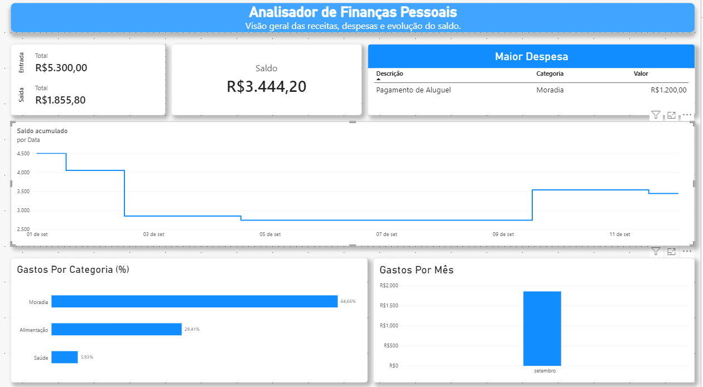

# Analisador financeiro
## Sobre o Projeto
Este projeto foi desenvolvido com o objetivo de analisar as finanças pessoais, permitindo acompanhar o saldo, as despesas e as transações financeiras. Comecei esse projeto porque queria me aprofundar nas ferramentas utilizadas e aprimorar o meu portfólio.

Foram utilizadas as tecnologias Python, SQL, SQLite e Power BI para manipular os dados e apresentar as informações por meio de visualizações.

## Tecnologias Utilizadas 
- **SQL:** o arquivo `01_criar_tabelas.sql` cria tabelas, o arquivo `02_inserir_dados.sql` insere dados e o arquivo `03_consultas.sql` realiza as consultas no banco de dados.

- **Python:** o arquivo `rodar_sql.py` conecta ao banco, abre e lê o arquivo `sql/03_consultas.sql` e executa o comando lido. O arquivo `relatorio.py` executa as consultas e apresenta os resultados no terminal.

- **SQLite:** o arquivo `banco.db` armazena os dados das transações financeiras.

- **Power BI:** o arquivo `dashboard_financeiro.pbix` contém o dashboard que apresenta os resultados do `banco.db` por meio de gráficos e indicadores.

## Funcionalidades 
- Apresenta um resumo das entradas e saídas das transações 

- Informa o saldo atual

- Mostra os gastos por mês e por categoria

- Identifica a maior despesa

- Exibe a evolução do saldo

## Estrutura do Banco
Tabela `transacoes`:

| Coluna | Tipo | Descrição |
|---|---|---|
|`id`| INTEGER PRIMARY KEY | identificador único de cada transação|
|`data`| DATE | registra em que a transação ocorreu|
|`descricao`| TEXT | informa qual foi a transação|
|`categoria`| TEXT |classifica as transações em grupos|
|`tipo`| TEXT |indica se a transação é uma `Entrada` ou uma `Saída`|
|`valor`| REAL |informa o valor de cada transação|

## Como Rodar

### Pré-requisitos
- Python 3.14.7

- SQLite3 ODBC Driver, 64 bits (`sqliteodbc_w64.exe`): permite que o Power BI leia o banco de dados

- Power BI Desktop

### Rodando o relatório
1. Abra o terminal na pasta do projeto, a que contém `banco.db`​.

2. Execute o comando `python relatorio.py`.

3. O terminal exibirá o resultado das consultas das transações.

### Abrindo o dashboard
1. Abra  “Fontes de Dados ODBC (64 bits)” no Windows.

2. Na aba “DSN de Usuário”, clicque em “Adicionar”.

3. Escolha `SQLite3 ODBC Driver` e clicque em “Concluir”.

4. No campo “Data Source Name”, digite `analisador_financeiro`.

5. No campo “Database Name”, clique em “Browse” e escolha o `banco.db` da pasta do projeto.

6. Clique em “OK” para salvar.

7. Abra o `dashboard_financeiro.pbix` no Power BI Desktop.

8. Clique em “Atualizar”, na aba “Página Inicial” do Power BI. Se ele pedir credenciais, escolhe a aba “Padrão ou Personalizada” e clique em “Conectar”.

## Limitações
- Os dados cadastrados são fictícios e eles cobrem apenas um mês.

- O programa não analisa a parte de vendas, apenas as finanças pessoais.

- O Power BI Desktop roda apenas no sistema operacional do Windows, não há versão para macOS nem Linux.
